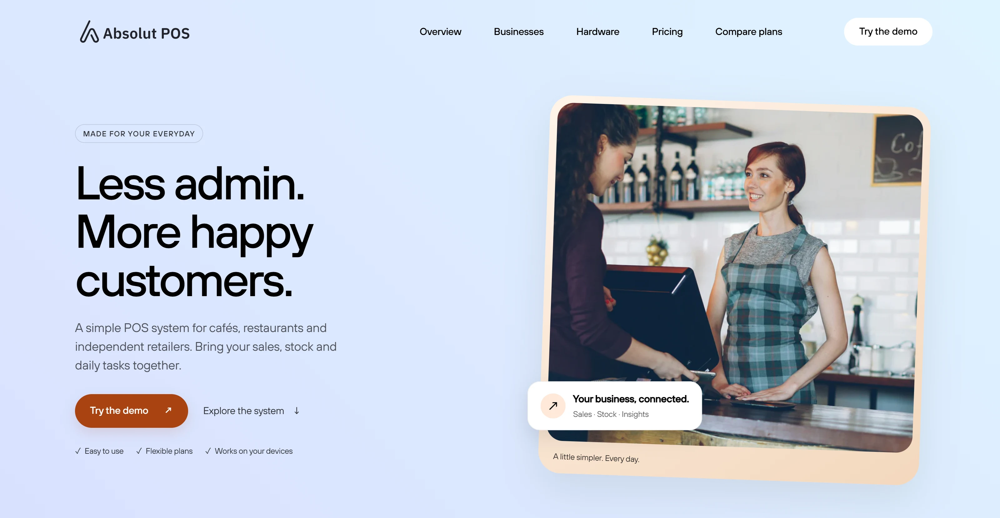
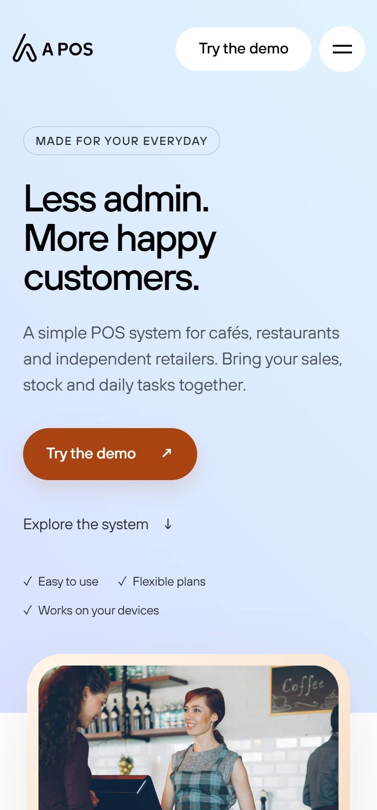
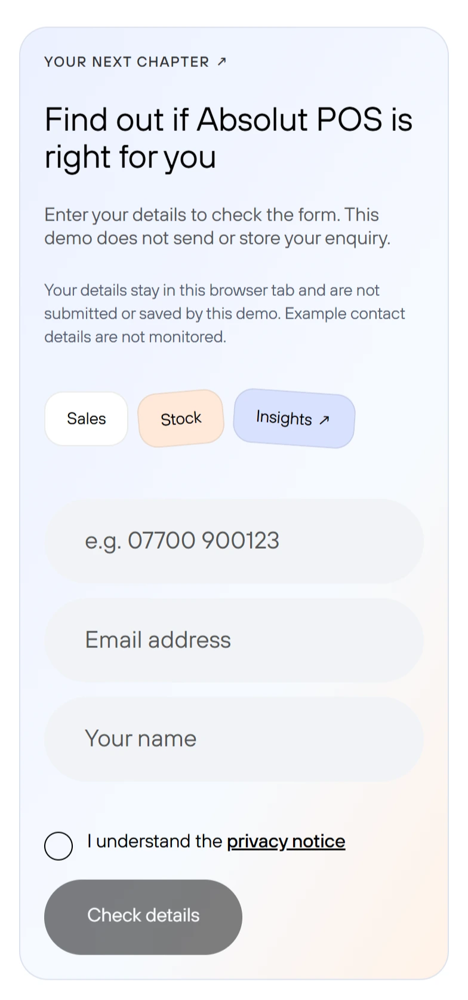
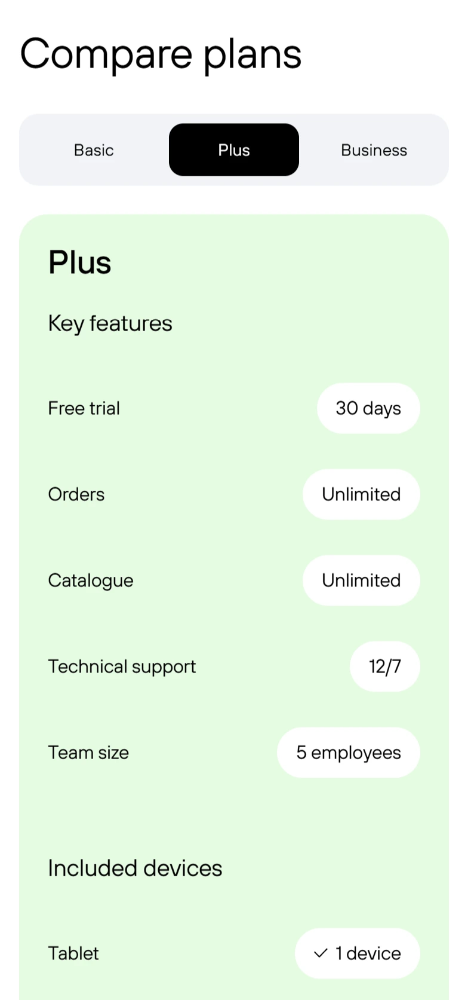

# Absolut POS — Responsive Multi-page Website

A responsive marketing website for a café and retail point-of-sale product, implemented from a Figma design with **HTML, SCSS and vanilla JavaScript**.

**[View live demo](https://ikatenev.github.io/Digitalizing-for-Cafes/)** · [Pricing & hardware](https://ikatenev.github.io/Digitalizing-for-Cafes/pricing.html) · [Compare plans](https://ikatenev.github.io/Digitalizing-for-Cafes/plans.html)

## Preview

[](https://ikatenev.github.io/Digitalizing-for-Cafes/)

<p align="center">
  
  
  
</p>

## Overview

The project covers three connected pages:

| Page | What it shows |
| --- | --- |
| **Overview** | Hero section, product benefits, business categories and calls to action. |
| **Pricing & hardware** | Product-related content, hardware and pricing sections. |
| **Compare plans** | Feature comparisons and interactive plan selection on smaller screens. |

## Frontend features

- **Responsive layouts:** adaptable sections, cards and navigation across mobile, tablet and desktop sizes.
- **Interactive JavaScript:** mobile menu, horizontally scrollable card sections, back-to-top control and keyboard-operable plan comparison tabs.
- **Form handling:** client-side validation with clear error/success feedback; demo mode deliberately makes no network submission.
- **Performance-minded assets:** responsive WebP images, appropriately loaded offscreen images and reduced-size local web fonts.
- **Accessibility and discoverability:** semantic HTML, visible keyboard focus, reduced-motion support, page-specific metadata and Open Graph tags.

## Tech stack

**Vite · HTML5 · SCSS (BEM) · JavaScript (ES modules) · Playwright · Lighthouse · GitHub Actions**

The project uses build-time shared HTML partials, separate page stylesheet entry points and small feature-based JavaScript modules. No runtime frontend framework is required.

## Quality checks

The GitHub Pages workflow runs linting, formatting checks, automated tests and Lighthouse performance checks **before** deployment.

- ESLint, Stylelint and Prettier
- Node.js unit/configuration tests
- Playwright browser tests for navigation, responsive overflow, interactive controls and form behaviour
- Lighthouse budget checks on the production build

[View deployment and checks](https://github.com/IKatenev/Digitalizing-for-Cafes/actions/workflows/deploy.yml)

Performance results are measured in a controlled environment and can vary on the deployed site and real devices. The [implementation report](IMPROVEMENT_PLAN.md) records the methodology and previous local measurements.

## Run locally

Requires **Node.js 22.19+**.

```bash
git clone https://github.com/IKatenev/Digitalizing-for-Cafes.git
cd Digitalizing-for-Cafes
npm ci
npm run dev
```

The development server uses `http://127.0.0.1:5173/Digitalizing-for-Cafes/`.

```bash
npm run build           # Build the three-page site into dist/
npm run preview         # Preview the production build
npm run lint            # Check JavaScript and SCSS
npm run format:check    # Check formatting
npm run test:unit       # Run configuration/backend unit tests
npm run test:chrome     # Run Playwright browser tests (install browsers first)
npm run audit:performance  # Run local Lighthouse checks after building
```

For browser tests, install Playwright's browser binaries using `npx playwright install`.

## Project structure

```text
index.html, pricing.html, plans.html   Main website pages
partials/                              Shared HTML sections
src/scss/                              Styles, components and page entries
src/js/modules/                        JavaScript interactions
vite-plugins/                          Build-time HTML includes
scripts/                               Image preparation and performance auditing
tests/                                 Automated tests
.github/workflows/                     Validation and Pages deployment
server/telegram/                       Optional, separately hosted enquiry backend
```

## Demo limitations and attribution

GitHub Pages hosts only the static frontend. The optional Cloudflare Worker in `server/telegram/` is **not required** for the portfolio demo; see its [setup guide](server/telegram/README.md) if you need a separate backend.

This repository showcases the **frontend implementation from a supplied design**. It does not demonstrate or claim ownership of the underlying POS product, brand or third-party design assets. Design and other original credits are retained on the website.

> **Portfolio demo:** This repository demonstrates a website frontend, not working POS software. The published contact form validates input in the browser but does not send or store enquiries. Prices and contact details are illustrative.